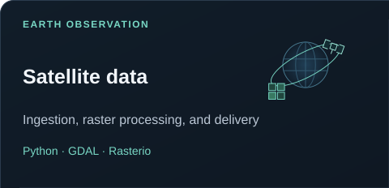
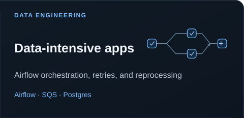
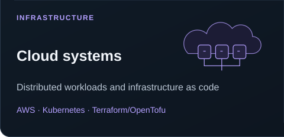
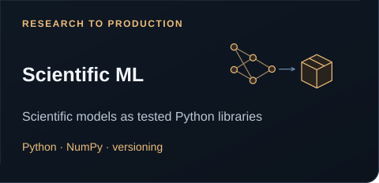
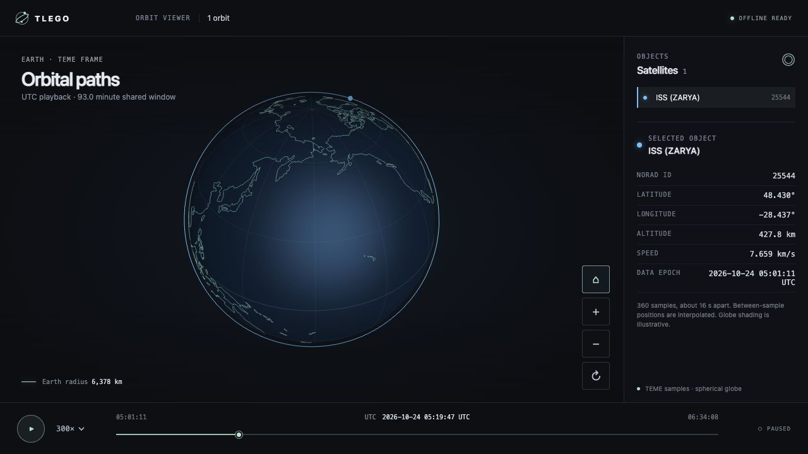
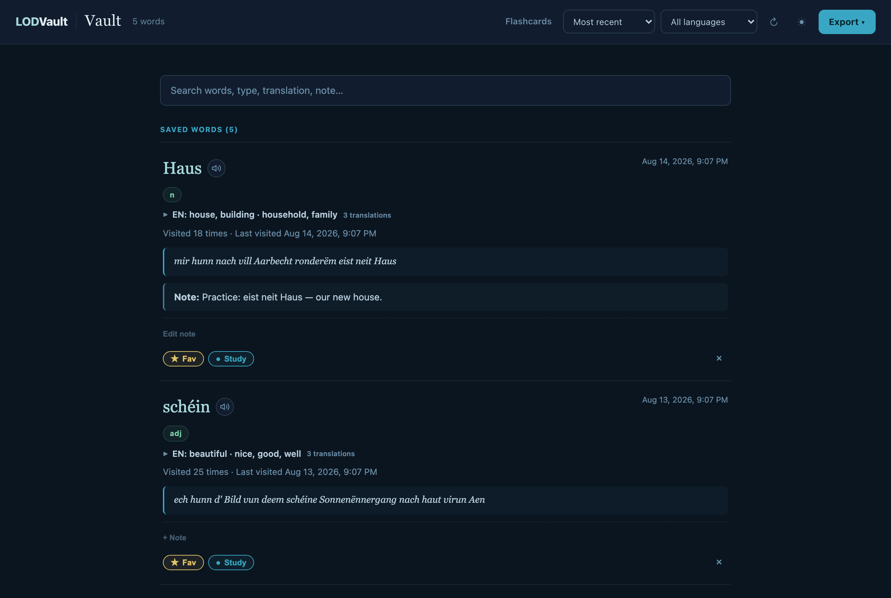
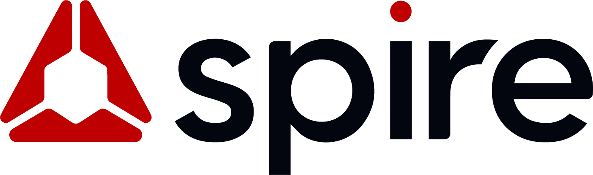
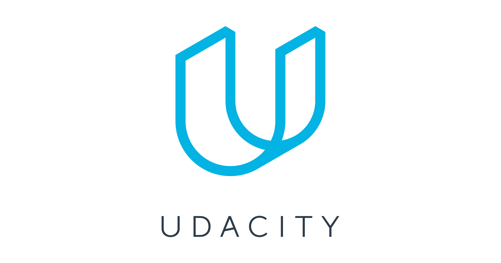
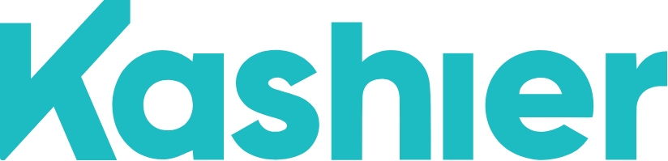

# Mohammed Ashour

Senior software engineer working on satellite data systems. Based in Luxembourg.

[CV](https://cv.m-ashour.space) · [Blog](https://blog.m-ashour.space) · [LinkedIn](https://www.linkedin.com/in/malyashour/) · [Email](mailto:m.aly.ashour@gmail.com)

## Now

I'm a Senior Data Engineer at [Hydrosat](https://hydrosat.com/), building satellite imagery pipelines, from ingestion and scientific processing to quality checks and delivery. I work with scientists and product teams to turn research into production software.

I've spent 9+ years building data-intensive software. At Spire Global, I built real-time satellite data systems, led engineering for ML-based sea ice detection, and helped reduce AWS costs by approximately $250K a year.

## Specialties

  
  
  
  

- Satellite data processing and delivery with Python, GDAL, and Rasterio.
- Data-intensive apps with Airflow orchestration, retries, and reprocessing. SQS and Postgres.
- Cloud systems with AWS, Kubernetes, and Terraform/OpenTofu.
- Scientific ML with tested, versioned Python libraries and NumPy.

I also work with Go and SQL.

## Selected projects

### [TLEGO](https://github.com/Mohammed-Ashour/tlego)

Browse satellites, track positions, and export interactive orbit views. Built in Go with a terminal UI.

<table>
  <tr>
    <td width="50%" valign="top">
      <h3><a href="https://github.com/Mohammed-Ashour/lod-vault">LODVault</a></h3>
      
A browser extension for saving Luxembourgish vocabulary, reviewing flashcards, and exporting to Anki.

      
    </td>
    <td width="50%" valign="top">
      <h3><a href="https://github.com/Mohammed-Ashour/lod-pane">LOD pane</a></h3>
      
A Luxembourgish dictionary sidebar for Word and LibreOffice. Look up words and keep a local vocabulary notebook.

      
      
Early implementation. Verified in LibreOffice; Word acceptance testing is still open.

    </td>
  </tr>
</table>

## Companies I've worked with

<table>
  <tr>
    <td align="center"><a href="https://hydrosat.com/"> Hydrosat</a></td>
    <td align="center"><a href="https://spire.com/"> Spire Global</a></td>
    <td align="center"><a href="https://www.yaoota.com/"> Yaoota</a></td>
    <td align="center"><a href="https://www.udacity.com/"> Udacity</a></td>
    <td align="center"><a href="https://kashier.io/"> Kashier</a></td>
  </tr>
</table>

I also write and teach about software engineering, data systems, and machine learning. Away from code, I enjoy chess, anime, books, and philosophy.
